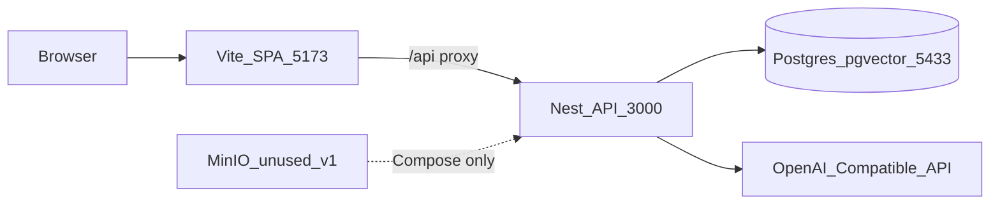
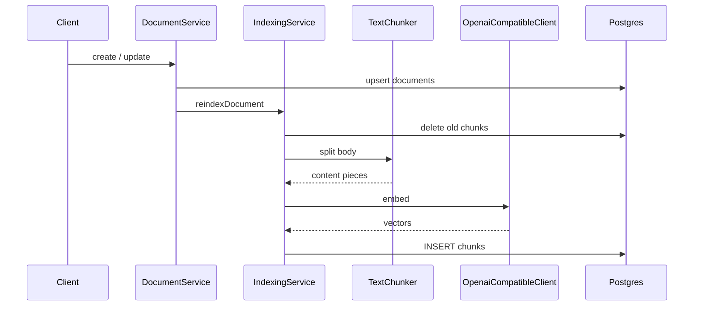
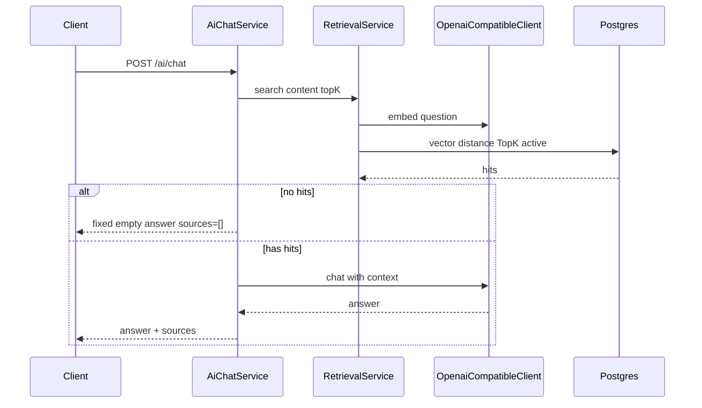

# AskForge 架构知识库

前后端框架、模块边界与数据流总览。启动步骤见 [README.md](README.md)；需求/规格见 [docs/specs/v1.md](docs/specs/v1.md) 与 OpenSpec；代码设计细节见 [docs/superpowers/specs/2026-10-28-minimal-rag-design.md](docs/superpowers/specs/2026-10-28-minimal-rag-design.md)。

---

## 1. 项目定位

AskForge 是用于学习 RAG 的最小知识库：文档入库 → 切块/Embedding → pgvector 检索 → 非流式问答。

| 层 | 技术 |
|----|------|
| 后端 | NestJS 11 + TypeORM + Passport JWT + PostgreSQL 驱动 |
| 前端 | Vite 5 + React 18 + Ant Design 5 + React Router 6 |
| 数据 | PostgreSQL 15 + pgvector |
| 中间件 | Docker Compose（Postgres / pgAdmin / MinIO） |
| 模型 | OpenAI 兼容 Embedding + Chat API（默认 DashScope compatible-mode） |

**v1 边界**：MinIO 仅 Compose 预置，应用不连接；鉴权为 stub 演示账号；问答非流式；无用户表。

---

## 2. 仓库地图

无根级 `package.json`；前后端各自独立包。

| 路径 | 职责 |
|------|------|
| `backend/` | NestJS API；`src/` 源码；`init-scripts/postgresql/init.sql` 建表 |
| `frontend/` | Vite React SPA |
| `docker-compose.yml` | Postgres、pgAdmin、MinIO |
| `.env` / `.env.example` | 根环境变量（密钥不入库）；后端亦可读 `backend/.env` |
| `docs/` | Agent 规范、v1 摘要、superpowers 设计/计划 |
| `openspec/` | 需求与规格变更 |
| `AGENTS.md` | 协作者 / Agent 约定入口 |
| `README.md` | 本地启动与冒烟 |

---

## 3. 系统架构

请求路径（开发）：浏览器 → `http://127.0.0.1:5173` → Vite 将 `/api/*` 代理到 Nest `3000`（去掉 `/api` 前缀）→ Nest 读写 PG / 调用 Embedding·Chat。

---

## 4. 基础设施

### Compose 服务

| 服务 | 容器名 | 宿主端口 | 用途 |
|------|--------|----------|------|
| `postgres` | `askforge-postgres` | `5433→5432` | 业务库 + pgvector；挂载 `init.sql` |
| `pgadmin` | `askforge-pgadmin` | `8089→80` | 图形客户端 |
| `minio` | `askforge-minio` | `9010` API / `9011` Console | 预置对象存储；**v1 应用不接** |

Volumes：`askforge_pg_data`、`askforge_pgadmin_data`、`askforge_minio_data`。

### Schema（`backend/init-scripts/postgresql/init.sql`）

| 表 | 角色 |
|----|------|
| `documents` | 文档元数据与正文；`status`：`active` / `deleted`（软删） |
| `chunks` | 切块正文 + `embedding vector(1024)`；`document_id` CASCADE |

`EMBEDDING_DIMS` 须与 `vector(N)` 及模型输出一致（默认 1024）。TypeORM **`synchronize: false`**，表结构以 SQL 为准。

---

## 5. 后端框架

### 入口与根模块

| 文件 | 说明 |
|------|------|
| [`backend/src/main.ts`](backend/src/main.ts) | `NestFactory`；CORS；全局 `ValidationPipe`（whitelist / transform / forbidNonWhitelisted）；监听 `PORT`（默认 3000） |
| [`backend/src/app.module.ts`](backend/src/app.module.ts) | `ConfigModule`（`.env`、`../.env`）+ `TypeOrmModule` + 三大业务模块 |

### 业务模块

| 模块 | 目录 | 职责 |
|------|------|------|
| `AuthModule` | [`backend/src/auth/`](backend/src/auth/) | 演示登录、JWT 签发、Passport 策略与 Guard |
| `DocumentModule` | [`backend/src/document/`](backend/src/document/) | 文档 CRUD；写路径触发索引 |
| `AiModule` | [`backend/src/ai/`](backend/src/ai/) | 切块、Embedding/Chat 客户端、索引、检索、问答 |

### Auth 关键文件

| 文件 | 说明 |
|------|------|
| `auth.controller.ts` | `POST /auth/login`、`GET /auth/me` |
| `auth.service.ts` | 比对 `DEMO_USERNAME` / `DEMO_PASSWORD`；签发 JWT（`JWT_SECRET`，7d）；固定 demo 用户 UUID |
| `jwt.strategy.ts` / `jwt-auth.guard.ts` | Bearer JWT |
| `dto/login.dto.ts` | 登录入参校验 |

无用户表；鉴权为学习用 stub。

### Document 关键文件

| 文件 | 说明 |
|------|------|
| `document.controller.ts` | REST CRUD，均需 JWT |
| `document.service.ts` | create/update → 调索引；delete → 软删 + 清 chunks |
| `entities/document.entity.ts` | → `documents` |
| `entities/chunk.entity.ts` | → `chunks`；**embedding 不映射 TypeORM**，写入/检索用 raw SQL |
| `dto/create-document.dto.ts` / `update-document.dto.ts` | `title`、`body` |

### Ai 关键文件

| 文件 | 说明 |
|------|------|
| `ai.controller.ts` | `POST /ai/chat`（JWT） |
| `ai-chat.service.ts` | 检索 → 拼上下文 → Chat → `{ answer, sources }`；无命中不调 Chat |
| `indexing.service.ts` | 删旧 chunks → 切块 → embed → INSERT |
| `retrieval.service.ts` | 问题 embed + `<=>` TopK；仅 `status=active` |
| `text-chunker.ts` | 按 `CHUNK_SIZE` / `CHUNK_OVERLAP` 切分 |
| `openai-compatible.client.ts` | Embedding / Chat HTTP 客户端 |
| `dto/chat.dto.ts` | `content`；`topK?`（1–20，默认 5） |

---

## 6. RAG 数据流

### 写入索引

软删：`status=deleted` + `IndexingService.deleteByDocument`（清 chunks）。

### 问答

`sources` 项：`documentId`、`title`、`chunkOrdinal`、`snippet`（正文截断约 240 字）。

---

## 7. API 表面

| Method | Path | 鉴权 | 入参要点 | 响应要点 |
|--------|------|------|----------|----------|
| `POST` | `/auth/login` | 公开 | `{ username, password }` | `{ accessToken, user }` |
| `GET` | `/auth/me` | JWT | — | 演示用户 |
| `POST` | `/documents` | JWT | `{ title, body? }` | 文档实体 |
| `GET` | `/documents` | JWT | — | active 列表 |
| `GET` | `/documents/:id` | JWT | UUID | 单条 |
| `PATCH` | `/documents/:id` | JWT | `{ title?, body? }` | 更新后实体 |
| `DELETE` | `/documents/:id` | JWT | UUID | `{ ok: true }`（软删） |
| `POST` | `/ai/chat` | JWT | `{ content, topK? }` | `{ answer, sources }` |

冒烟步骤：[backend/curl-smoke.md](backend/curl-smoke.md)；README 亦有精简 curl。

---

## 8. 前端框架

### 入口与壳

| 文件 | 说明 |
|------|------|
| [`frontend/src/main.tsx`](frontend/src/main.tsx) | Ant Design `zh_CN`；品牌黄主题 `#e8b20a`；`BrowserRouter` |
| [`frontend/src/App.tsx`](frontend/src/App.tsx) | 路由表；`Guard` 读登录态 |
| [`frontend/src/layouts/AppLayout.tsx`](frontend/src/layouts/AppLayout.tsx) | 侧栏「文档 / 问答」、顶栏；挂载时 `authApi.me()` |
| [`frontend/src/components/BrandLogo.tsx`](frontend/src/components/BrandLogo.tsx) | 品牌标识 |
| [`frontend/src/index.css`](frontend/src/index.css) | 样式；类名前缀 `af-` |

### 路由与页面

| 路由 | 页面文件 | 说明 |
|------|----------|------|
| `/login` | `pages/LoginPage.tsx` | 登录；已登录则跳文档列表 |
| `/` | — | 重定向 `/documents` |
| `/documents` | `pages/DocumentsPage.tsx` | 列表 |
| `/documents/new` | `pages/DocumentEditPage.tsx` | 新建 |
| `/documents/:id/edit` | `pages/DocumentEditPage.tsx` | 编辑 |
| `/documents/:id` | `pages/DocumentDetailPage.tsx` | 详情 |
| `/chat` | `pages/ChatPage.tsx` | 非流式问答；Markdown 渲染；topK 固定 5 |

未匹配路径按登录态回 `/documents` 或 `/login`。

### API 与鉴权客户端

| 文件 | 说明 |
|------|------|
| [`frontend/src/api/client.ts`](frontend/src/api/client.ts) | `fetch` + Bearer；基址 `VITE_API_BASE` 或 `/api`；非 login 的 401 清态 |
| [`frontend/src/api/index.ts`](frontend/src/api/index.ts) | `authApi` / `documentApi` / `aiApi` |
| [`frontend/src/auth.ts`](frontend/src/auth.ts) | `localStorage`：`af_access_token` / `af_user`；`useSyncExternalStore` |
| [`frontend/src/types.ts`](frontend/src/types.ts) | `AuthUser`、`DocumentItem`、`ChatResult` 等 |

### 开发代理

[`frontend/vite.config.ts`](frontend/vite.config.ts)：`/api` → `http://127.0.0.1:3000`，rewrite 去掉 `/api`。默认开发地址 `http://127.0.0.1:5173`。

主要依赖：`antd`、`@ant-design/icons`、`react-router-dom`、`react-markdown`、`remark-gfm`。

---

## 9. 跨端约定

| 约定 | 说明 |
|------|------|
| 鉴权头 | `Authorization: Bearer <accessToken>` |
| 前端存证 | `af_access_token`、`af_user`（localStorage） |
| 401 | 非登录接口失败时前端清本地态并需重新登录 |
| 演示账号 | `DEMO_USERNAME` / `DEMO_PASSWORD`（在本地 `.env` 配置） |
| 品牌前缀 | 存储与样式统一 `af_` / `af-` |
| CORS | 后端开启；开发期经 Vite 同源代理即可 |

---

## 10. 配置索引

变量真源：[`.env.example`](.env.example)。下表仅列名称与用途，不含密钥。

| 分类 | 变量 |
|------|------|
| 数据库 | `DATABASE_HOST`、`DATABASE_PORT`、`DATABASE_USER`、`DATABASE_PASSWORD`、`DATABASE_NAME` |
| pgAdmin | `PGADMIN_DEFAULT_EMAIL`、`PGADMIN_DEFAULT_PASSWORD` |
| 鉴权 | `JWT_SECRET`、`DEMO_USERNAME`、`DEMO_PASSWORD` |
| 模型 | `OPENAI_BASE_URL`、`OPENAI_API_KEY`、`EMBEDDING_MODEL`、`CHAT_MODEL`、`EMBEDDING_DIMS` |
| 切块 | `CHUNK_SIZE`、`CHUNK_OVERLAP` |
| 服务 | `PORT` |

前端可选（代码读取，未写入 `.env.example`）：`VITE_API_BASE`（缺省走 `/api` 代理）。

本地习惯：根目录 `.env` 填好后可 `cp .env backend/.env`，与 README 一致。

---

## 11. 延伸阅读

| 文档 | 何时看 |
|------|--------|
| [README.md](README.md) | 环境、Compose 启动、冒烟 curl |
| [AGENTS.md](AGENTS.md) | Agent / 协作原则与文档归属 |
| [docs/agents/dev-flow.md](docs/agents/dev-flow.md) | OpenSpec × superpowers 闸门 |
| [docs/agents/rules.md](docs/agents/rules.md) | Nest/TS 注释与代码约定 |
| [docs/agents/glossary.md](docs/agents/glossary.md) | RAG 术语 |
| [docs/specs/v1.md](docs/specs/v1.md) | v1 能力边界摘要 |
| [docs/superpowers/specs/2026-10-28-minimal-rag-design.md](docs/superpowers/specs/2026-10-28-minimal-rag-design.md) | 最小 RAG 代码设计 |
| [docs/superpowers/plans/2026-10-28-minimal-rag.md](docs/superpowers/plans/2026-10-28-minimal-rag.md) | 最小 RAG 执行分片 |
| [openspec/changes/bootstrap-minimal-rag/](openspec/changes/bootstrap-minimal-rag/) | 首版 RAG 需求与规格 |
| [openspec/changes/add-compose-guis/](openspec/changes/add-compose-guis/) | pgAdmin / MinIO Console |
| [openspec/changes/annotate-learning-source/](openspec/changes/annotate-learning-source/) | 源码学习注释 |
| [openspec/changes/unify-askforge-branding/](openspec/changes/unify-askforge-branding/) | 品牌与命名统一 |
| [backend/curl-smoke.md](backend/curl-smoke.md) | 后端 login → document → chat 冒烟 |
